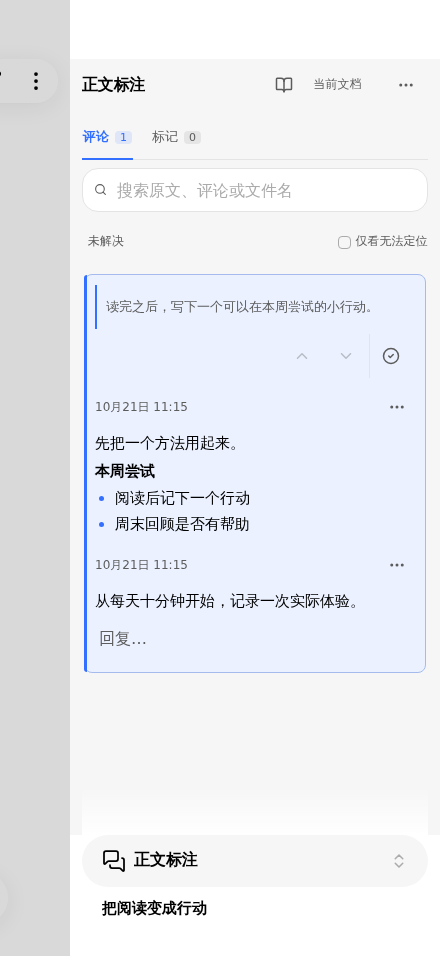
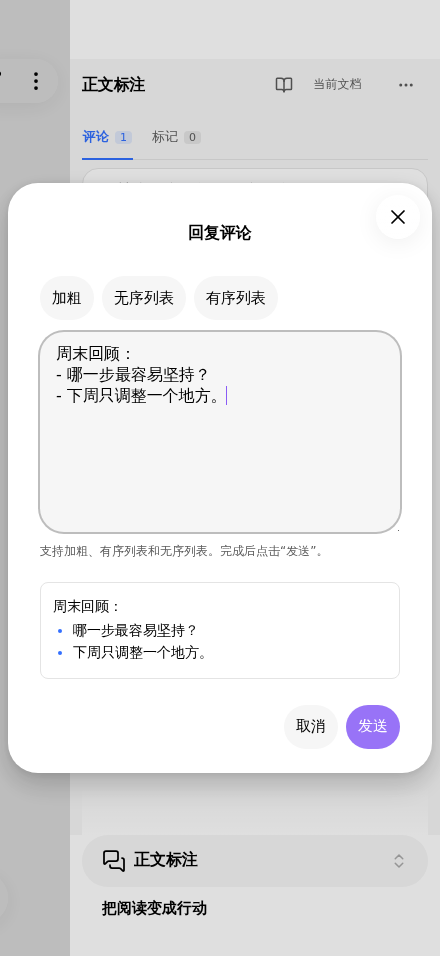

# Highnote

**Keep your thoughts beside the text. Return to them when you need them.**

Highnote brings compact comments and highlights to Markdown reading in Obsidian, a review dashboard with a date heatmap, and flexible exports for flomo. Your annotations stay in your vault without being inserted into the Markdown source.

[Community page](https://community.obsidian.md/plugins/highnote) · [Download a release](https://github.com/jinchengrui/obsidian-highnote/releases) · [Phone and tablet](#phone-and-tablet) · [Sync and migration](#your-notes-and-your-data) · [中文说明](#中文说明)

**Obsidian 1.14.4+ · Desktop, phone and tablet annotations · Chinese interface · Free and open source**

Screenshots use example notes and the Chinese interface. Mobile screenshots below are captured in Obsidian mobile emulation.

## Compact comments beside your notes

Select a passage in Reading view to add a comment or highlight. The comment dialog displays the original passage above the input, including when editing a comment or replying on mobile; long passages scroll within the reference area. The compact sidebar keeps the original excerpt above your thoughts, with full comments and replies available in the discussion. On desktop, hover to reveal reply controls; the surrounding cards stay in place.

- **Stay with the text.** Select a discussion to highlight its passage. Click its source excerpt to navigate; selecting comment text keeps your reading position.
- **Keep a thought going.** Add replies, edit or delete individual messages, and resolve a discussion when you are finished. Comments support bold text and ordered or unordered lists.
- **Find it again.** Browse the current note or all notes, search excerpts and comments, and filter resolved or unresolved discussions. All-note summaries group related messages to use less space.

Previous/next discussion buttons are hidden by default to leave more room for the source excerpt. Enable **显示评论导航按钮** (Show comment navigation buttons) in **Settings → Highnote** when you need them; the change takes effect immediately.

The sidebar follows Obsidian's light and dark themes. Highlights use one shared color, configurable in settings. This is a personal annotation tool; no author avatars, accounts, mentions, or collaboration setup are needed.

## Phone and tablet

Use **Highnote 1.0.34 or later** for the mobile reply dialog and compact landscape layout. Enable Highnote on each device; no mobile feature switch is required.

1. Open a Markdown note in **Reading view**. Long-press a passage and adjust the selection.
2. Tap **评论** (Comment) or **标记** (Highlight) in the bottom toolbar. Highlights use the color selected in settings and leave you in the note.
3. Tap an underline or highlight to open its annotation drawer. You can edit or delete messages, add replies, and resolve or reopen discussions.
4. Tap **回复** (Reply) to open a separate input dialog. Enter inserts a newline; **发送** (Send) submits the reply. Rotating the screen preserves your draft. **返回阅读** (Return to reading) closes the drawer.

In short landscape windows, search and status filters are behind the **展开或收起筛选** (Expand or collapse filters) button. The reply dialog adapts to the available height when the keyboard opens. Tablet portrait, landscape and split-screen layouts use the available pane width.

  
  

For Reading review, use the book icon or open the command palette and choose **Highnote: 打开阅读回顾**. **Highnote: 打开评论** opens the annotation drawer. If the commands are missing, check that Highnote is enabled and that you installed the current plugin files.

Phone landscape, rotation and reduced-height input have been checked in Obsidian mobile emulation. Native iOS text selection, safe areas and the software keyboard have not yet been verified on physical iPhone or iPad hardware.

## Review your reading by date

Open **阅读回顾** (Reading review) from the annotation sidebar menu or the **Highnote: 打开阅读回顾** command to bring saved annotations into one workspace. On mobile, the heatmap starts collapsed.

- Switch between comments and highlights, and between the current note and all notes.
- Use the heatmap to select a date, or search original excerpts, comments, and source note names. A matching discussion retains its context and related replies.
- Open a card's source details and choose **回到原文** (Back to source) to return to the note. Wide desktop windows can show the review and source side by side; mobile opens the source in a note tab.

The heatmap counts annotation records by creation date; it does not measure time spent reading. The review uses your current saved annotations. It does not create a second archive of discussions. Original excerpts are retained from the time you annotated them, so a later source edit does not erase what prompted the thought.

## Take your thoughts to flomo

Choose **导出** (Export) in Reading review, then **flomo CSV**. Preview the result before saving a CSV file for import into flomo.

Choose one memo per discussion or one per message. Include replies, keep the original excerpt with your comments or export comments alone, and optionally append the source note name. Choose how successive messages are separated.

For a custom layout, use the template variables `{上下文}` (excerpt), `{评论}` (comments), `{来源}` (source), and `{记录日期}` (record date). The preview shows the actual `content` and `created_at` fields that will be written to the CSV. Long previews have a full-content view; exported content is not truncated.

**Export a local CSV, then import it into flomo.** Highnote does not connect to flomo or require a flomo API key.

| Format | Best for | Contents |
| --- | --- | --- |
| Markdown | Continuing to write in Obsidian | Original excerpts, comments or highlights, and source details |
| HTML | Reading outside Obsidian | A standalone file for offline browser reading |
| flomo CSV | Adding reading thoughts to flomo | Comments, optional replies and excerpts, and record dates |

Exports support the current note or all notes and are saved to the vault root. Existing filenames receive a numeric suffix. The document scope determines the export; review search, date filters, and on-screen pagination do not narrow it. Unsubmitted drafts and deleted messages are excluded. CSV is available for comments; highlights can be exported as Markdown or HTML.

Mobile review supports the same export formats. HTML and CSV are saved in the vault without launching a desktop application.

## Get started

1. In Obsidian, open **Settings → Community plugins → Browse**, search for **Highnote**, and install and enable it. You can also use the [community page](https://community.obsidian.md/plugins/highnote). If your client cannot find the listing, use the manual files below.
2. Open a Markdown note in **Reading view**. Select a passage on desktop, or long-press it on a phone or tablet, and choose Comment or Highlight.
3. Open the annotation drawer to continue a discussion, or Reading review to browse and export annotations.

Creating or modifying annotations requires Reading view. In Source mode or Live Preview, you can read existing annotations in the sidebar or Reading review; selection tools and passage decorations appear only in Reading view.

Manual installation and updates

Download **`main.js`, `manifest.json`, and `styles.css` from the same version** on [GitHub Releases](https://github.com/jinchengrui/obsidian-highnote/releases). Put all three in `.obsidian/plugins/highnote/` inside your vault, then enable Highnote in **Settings → Community plugins**. Use your actual configuration directory if it has a different name. After replacing the files for an update, disable and re-enable the plugin.

GitHub's automatically generated **Source code** archives contain development files; the three built files above are what Obsidian loads. Installing or syncing the plugin does not automatically transfer your annotation JSON. See the data and sync instructions below.

## Your notes and your data

Annotations use **`Highnote/annotations/`** by default, with one JSON file per annotated note path. Change **批注数据目录** (Annotation data directory) in **Settings → Highnote** to any vault-relative directory, such as `Highnote/annotations`, and click **应用** (Apply). Enter the complete data directory; another `annotations` folder is not appended. Desktop, phone and tablet should use the same relative path. Highnote does not insert annotation markup into your Markdown source. Include the selected directory in backups or sync; copying a `.md` file alone does not copy its annotations. Exports are reading copies, not a replacement for the JSON backup.

### Sync across devices

Installing Highnote on another device does not copy your annotations. Sync **both the Markdown notes and the configured annotation directory**, and enable the plugin separately on each device.

For [Obsidian Sync](https://help.obsidian.md/sync/settings):

1. Connect the devices to the same remote vault.
2. In **Settings → Highnote → 批注数据目录**, use the same vault-relative path on every device, for example `Highnote/annotations`, then click **应用** (Apply).
3. Enable **Sync all other types** on each device so that JSON files are included. Make sure `Highnote` is not an excluded folder.
4. Wait for synchronization, then tap **刷新** (Refresh) in mobile Reading review.

Obsidian Sync excludes ordinary hidden folders such as `.obsidian-highnote`. Move that data using the migration option below before syncing it through the default visible directory. If you use another sync tool, configure it to include the annotation JSON files.

The mobile annotation directory or Reading review is empty

- Check the configured directory on the device that has your comments. If its data is still in `.obsidian-highnote`, migrate it on desktop first.
- If the desktop has `note-….json` files but the phone does not, check the sync settings and exclusions above. Copying only Markdown notes or plugin files does not transfer annotations.
- If JSON files are already on the phone, check **批注数据目录**, tap Refresh, and clear any document, search or date filters in Reading review.
- If the same directory remains unreadable, record the error shown by Highnote and include it in an issue. Keep the original JSON backup.

### Migrate existing annotations on desktop

In **Settings → Highnote → 迁移批注数据**, the source is prefilled with `.obsidian-highnote` and the destination with `Highnote/annotations`. Review or change both paths, then click **迁移** (Migrate).

Highnote reads note JSON files from the source directory and its `annotations` subfolder, validates and copies them, and switches to the destination only after successful validation and settings save. Source files remain as a backup; future edits go to the new directory. Identical files are skipped. Conflicting or unsupported files stop the migration without being overwritten. Interrupted copies can be retried.

Upgrading retains an explicitly configured directory. Devices without a saved directory use `Highnote/annotations`. After migrating, point your phone and tablet to the new directory too. Markdown source and exported files are not moved.

The **应用** (Apply) button only switches the data location; **迁移** copies existing annotations as well. A missing directory is created when the first annotation is saved.

### Source changes and saved content

| When this happens | Highnote's behavior |
| --- | --- |
| A tracked edit changes the text before a passage | The anchor follows the edit when its position can be established reliably |
| A passage is removed or can no longer be located reliably | The saved excerpt and discussion remain available, marked as unlocatable |
| A note or folder is renamed inside Obsidian | Annotation paths are updated |
| A source note is deleted on desktop | Annotations remain available with a missing-source state |
| A source note is unavailable on mobile | Saved annotations remain available; Highnote does not write a deletion state just because the local note is missing |
| Another process changes the annotation file before a save | The conflicting save stops; the input draft is retained for retry |
| The last message in a discussion is deleted | The empty discussion and underline are removed; a separate highlight is retained |

Drafts last only for the current plugin session. Migration supports the current per-note JSON schema; unsupported older test formats are reported without modifying them. Empty JSON files may remain after annotations are deleted or a note is moved; they contain no historical message snapshot and can be reused by that note path.

Selection works best with ordinary text in a paragraph or list. Selections across complex rendered blocks, embeds, tables, or formulas may not map reliably to source text. Unlocatable passages are not silently rebound. Concurrent edits across devices are not automatically merged.

### Privacy and permissions

- **Network:** No network requests, telemetry, advertising, or automatic installation of updates or dependencies. Exports are saved locally; Highnote does not upload annotations. Downloading development dependencies is a separate build-time operation.
- **Filesystem:** Annotation reads and writes use Obsidian's `DataAdapter`. On desktop, `node:fs.watch` monitors only the configured annotation directory inside this vault to detect external changes, including hidden directories outside the regular Vault index. Changing directories closes the previous watcher; unloading closes the current watcher. This Node.js use does not read or write files outside the vault.
- **Clipboard:** The HTML exporter includes a **Copy path** button. Clicking it writes the note's vault-relative path to the clipboard. It never reads the clipboard or monitors clipboard changes.
- **External applications:** On desktop, opening an HTML export uses the system's default application for the saved local file. Mobile saves the file without launching an external application. Nothing is uploaded.

The review and sidebar render records in batches, and long discussions have message pagination. Mobile reuses unchanged JSON files and checks for external changes every 15 seconds while a reading, annotation or review view is active. Unchanged data does not trigger a list redraw; manual Refresh forces a reread. All saved content remains searchable and available for export. Saving one note still involves its JSON file, so the cost grows with that note's annotations.

## 中文说明

**在原文旁写下想法，回顾时读懂当时的自己。**

Highnote 为 Obsidian 的 Markdown 阅读提供简洁的批注侧栏、按日期回顾的看板，以及适合导入 flomo 的 CSV 导出。评论和标记保存在笔记库中，不写进 Markdown 正文。

适用于 **Obsidian 1.14.4 及以上**。电脑、手机和平板均支持评论、标记和阅读回顾；当前界面为中文。免费，使用 MIT 许可。

### 简洁批注，把空间留给内容

阅读模式选中文字，即可添加评论或高亮。侧栏按“原文在上、想法在下”展示，评论与回复保留全文，长讨论可翻页查看。桌面端回复入口悬停出现，不挤动卡片；选中的讨论带有淡蓝色背景，并与原文联动。

添加评论时，弹窗在输入框上方显示引用的原文，方便对照；编辑评论和移动端回复同样显示原文。长引用可在引用区内滚动查看全文，也可以复制。

点击原文摘录才跳转，选择评论文字时保持阅读位置。可以连续回复、编辑或删除消息，也可以把讨论标记为已解决。支持当前文档和全部文档查看，全部文档会合并展示同一讨论，让浏览更紧凑。侧栏跟随明暗主题，标记使用设置中统一指定的颜色。

上一条／下一条讨论按钮默认隐藏，右上角仅保留解决操作，原文摘录可以显示更多内容。需要连续浏览时，在“设置 → Highnote”中开启“显示评论导航按钮”，修改立即生效。

[查看批注侧栏截图](docs/screenshots/showcase-comments.png)

### 阅读回顾看板，找回散落的想法

从侧栏菜单打开“阅读回顾”，集中查看当前文档或全部文档的评论、回复与标记。热力图按创建日期展示记录数量，点击日期即可回看当天的记录；搜索支持原文、评论和来源文档。热力图统计批注记录，不统计阅读时长。

回顾页跟随已保存批注的变化，不会另外快照一份讨论。创建批注时的原文摘录会保留，便于理解当时的语境。打开“查看出处与讨论”后，可以通过“回到原文”定位。桌面窗口足够宽时，回顾与原文并排显示；手机和平板在笔记标签页打开原文。

[查看回顾看板](docs/screenshots/showcase-review.png) · [查看原文联动](docs/screenshots/showcase-source.png)

### 导出到 flomo，自己决定保留什么

在阅读回顾右上角点击“导出”，选择 **flomo CSV**。可以选择“一段讨论一条笔记”或“一条消息一条笔记”，决定是否包含回复、原文与来源。既可以保留“原文＋想法”，也可以只导出自己的评论。

自定义模板支持 `{上下文}`、`{评论}`、`{来源}`、`{记录日期}`，可调整内容顺序和多次评论之间的连接方式。右侧预览 CSV 的 `content`、`created_at` 字段，长内容可单独展开查看，保存的文件保留全文。

这是**先导出本地 CSV，再到 flomo 导入**的流程，不会自动同步，也不需要填写 flomo API Key。纯标记可导出 Markdown 或 HTML；flomo CSV 用于评论。

[查看 flomo 导出](docs/screenshots/showcase-flomo.png) · [查看自定义模板](docs/screenshots/showcase-template.png)

### 安装与使用

1. 在 Obsidian 的“设置 → 第三方插件 → 浏览”中搜索 **Highnote**，安装并启用，也可以从 [官方社区页](https://community.obsidian.md/plugins/highnote)进入。如果客户端暂时找不到插件，可按下方说明手动安装。
2. 打开 Markdown 笔记并切换到**阅读模式**。电脑选中文字，手机和平板长按选中文字，再点击评论或标记。
3. 从批注侧栏菜单或“Highnote：打开阅读回顾”命令进入回顾页，浏览记录并导出。

手动安装与更新

从 [GitHub Releases](https://github.com/jinchengrui/obsidian-highnote/releases) 下载**同一版本**的 `main.js`、`manifest.json`、`styles.css`，放入笔记库的 `.obsidian/plugins/highnote/`，再启用插件。若修改过 Obsidian 配置目录，请使用实际目录。更新时替换这三个文件，然后关闭并重新启用插件。

GitHub 自动生成的 **Source code** 压缩包是开发源码。Obsidian 运行插件需要上面三个构建文件。安装插件不会自动带来其他设备的批注，批注数据需要另外同步。

### 手机与平板批注

使用 **Highnote 1.0.34 及以上**可获得独立回复弹窗和紧凑横屏布局。每台设备启用插件即可，无需额外开启移动端开关。

1. 在 Markdown **阅读模式**下长按文字，调整选区，再点底部“评论”或“标记”。标记使用设置中的默认颜色，完成后留在正文。
2. 点原文下划线或高亮打开批注抽屉，可查看全文、回复、编辑、删除、解决或重新打开讨论。
3. 点击“回复”打开独立输入弹窗，回车换行，点击“发送”提交。旋转屏幕后草稿保留；“返回阅读”可收起批注抽屉。

手机横屏高度较小时，搜索与状态筛选默认收起，点击顶部“展开或收起筛选”按钮打开。评论和回复弹窗按键盘可视区域调整，iPad 横竖屏及分屏按可用宽度布局。编辑模式和实时预览下，可以在侧栏或回顾页查看批注；新增、修改和正文装饰仅在阅读模式下提供。

[查看手机批注](docs/screenshots/showcase-mobile-comments.png) · [查看回复弹窗](docs/screenshots/showcase-mobile-reply.png)

从书本图标或命令面板里的 **Highnote：打开阅读回顾** 进入回顾页；**Highnote：打开评论** 打开批注抽屉。搜索不到命令时，先检查插件是否启用、安装文件是否为新版。

手机横屏、旋转和低可视高度输入已经过 Obsidian 移动模拟验证。iOS 原生选词菜单、安全区与软键盘尚未在 iPhone、iPad 真机上验证。

### 同步和迁移批注

批注默认位于 `Highnote/annotations/`，每篇有批注的笔记对应一个 JSON 文件。电脑、手机和平板都应在“设置 → Highnote → 批注数据目录”中填写相同的完整相对目录。插件不会再追加一层 `annotations`。

**使用 Obsidian Sync 时：**

1. 每台设备连接同一个远程库，并将批注目录设为相同路径，例如 `Highnote/annotations`，点击“应用”。
2. 每台设备开启“同步所有其他类型”，让 JSON 参与同步；确认 `Highnote` 不在排除目录中。
3. 等待笔记和批注文件同步完成，再到手机阅读回顾点击“刷新”。

[Obsidian Sync 不同步普通隐藏目录](https://help.obsidian.md/sync/settings)，使用旧 `.obsidian-highnote` 目录时，请先在桌面端迁移。其他同步工具也需要包含批注 JSON。安装插件、只同步 Markdown 或只同步插件配置，都不能替代批注目录同步。

**迁移历史批注（桌面端）：** 打开“设置 → Highnote → 迁移批注数据”，源目录默认 `.obsidian-highnote`，目标目录预填 `Highnote/annotations`。确认或修改后点击“迁移”。插件读取源目录及其 `annotations` 子目录中的批注 JSON，校验复制并保存设置成功后才切换目录。

源文件保留为备份，后续修改写入新目录。相同文件跳过，冲突或格式不支持时停止，不覆盖；中断后可重试。升级保留明确配置过的目录，未配置时使用新默认。迁移后，手机和平板也要指向新目录。正文和导出文件不搬动。

“应用”只切换读写位置；“迁移”同时复制已有批注。不存在的目录在首次保存批注时创建。

手机目录为空，或阅读回顾没有内容

- 先检查有评论的那台设备当前使用的目录。数据还在 `.obsidian-highnote` 时，先在桌面端迁移。
- 电脑已有 `note-….json`，手机没有：检查同步类型和排除目录，等待 JSON 同步。插件安装成功并不表示批注也已同步。
- 手机已有 JSON：确认 Highnote 配置指向该目录，点击“刷新”，清除回顾页的文档范围、搜索和日期筛选。
- 仍无法读取时，保留原 JSON，记录 Highnote 的报错内容并反馈。

### 导出范围

在阅读回顾选择当前文档或全部文档后导出。文件保存到笔记库根目录，重名自动追加序号；搜索、日期筛选和分页不改变导出范围。未发送草稿和已删除消息不导出。

Markdown 和 HTML 支持评论、标记，flomo CSV 支持评论及可选回复。手机和平板也支持这些格式；HTML 与 CSV 保存到库内，交由合适的应用打开或导入。

### 备份、边界与隐私

- **备份整个批注目录。** 评论和标记默认位于 `Highnote/annotations/`，可在“批注数据目录”中配置。单独复制 Markdown 不会带走批注，导出文件也不能替代 JSON 备份。旧目录可在桌面端通过“迁移批注数据”手动迁移。
- **原文变化后保留想法。** 能可靠确认位置的编辑会更新锚点；原文删除或无法定位时保留摘录与讨论，不自动绑定到另一段相似文字，也不提供手动重新绑定。
- **保存冲突时停止覆盖。** 保存前检测到文件被同步工具或其他窗口改动时，停止当前保存，保留草稿供重新加载后重试。多设备同时写入仍可能冲突；未提交草稿不跨插件重启保存。
- **本地处理。** 插件不发起网络请求，不上传批注，不含遥测、广告、自更新或自动安装依赖。批注由 Obsidian DataAdapter 访问；桌面端 `node:fs.watch` 仅监听当前库的批注目录，卸载时关闭，手机版不加载 Node.js 或 Electron 模块。
- **手机缺少笔记时保留批注。** 原笔记尚未同步或暂时不可用时，不自动写入删除状态。移动端复用未变化的 JSON，阅读、批注或回顾界面活跃时每 15 秒检查文件变化；数据没变时不重画列表。
- **按操作使用剪贴板。** HTML 导出页的“复制路径”只在点击时写入库内相对路径，不读取或监听剪贴板；桌面端打开 HTML 文件时交给系统默认应用，移动端仅保存文件。

## Development

Use Node.js 22 or later. Install locked dependencies with `npm ci`; run `npm run dev` for a watch build. Before releasing, run `npm run check:source`, `npm run typecheck`, `npm run lint`, `npm test`, `npm run build`, and `npm run package`. Installable files are written to `dist/highnote/`.

When copying source into a local checkout, merge the complete source tree into the repository root, including `src/`, `scripts/`, `tests/`, and `.github/`. Keep the checkout's `.git` directory. `npm run check:source` reports missing entry points, local imports and build scripts.

The GitHub Actions workflow checks the project and generates artifact attestations for builds from the public repository's default branch. Upload the three files from that run unchanged to a GitHub Release whose tag exactly matches `manifest.json`'s version, without a `v` prefix. Local build files do not automatically have GitHub attestations.

如果通过 GitHub Desktop 更新源码，请把完整源码包的内容合并复制到仓库根目录，确认 `src`、`scripts`、`tests` 和 `.github` 齐全，保留原有 `.git`。推送后等待最新一次 Actions 全部通过，再使用该次构建产物发布。

## License and feedback

MIT. Copyright (c) 2026 jinchengrui. See [LICENSE](LICENSE).

[Report an issue](https://github.com/jinchengrui/obsidian-highnote/issues) · [更新记录](docs/更新记录.md)
