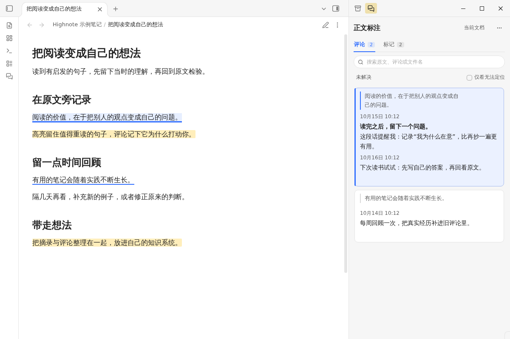
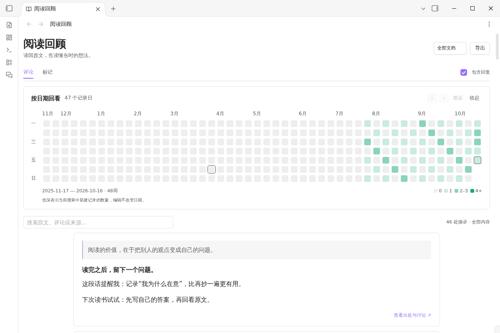
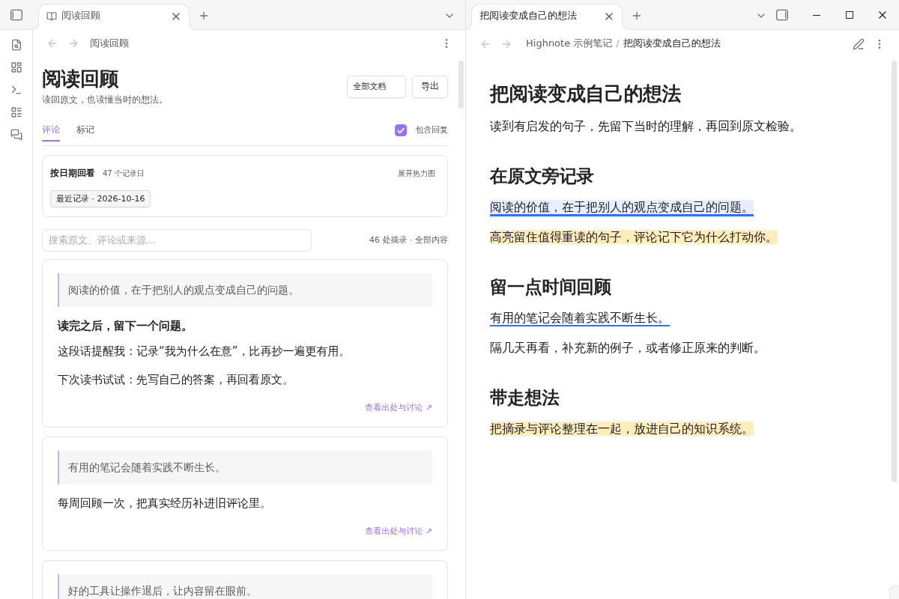
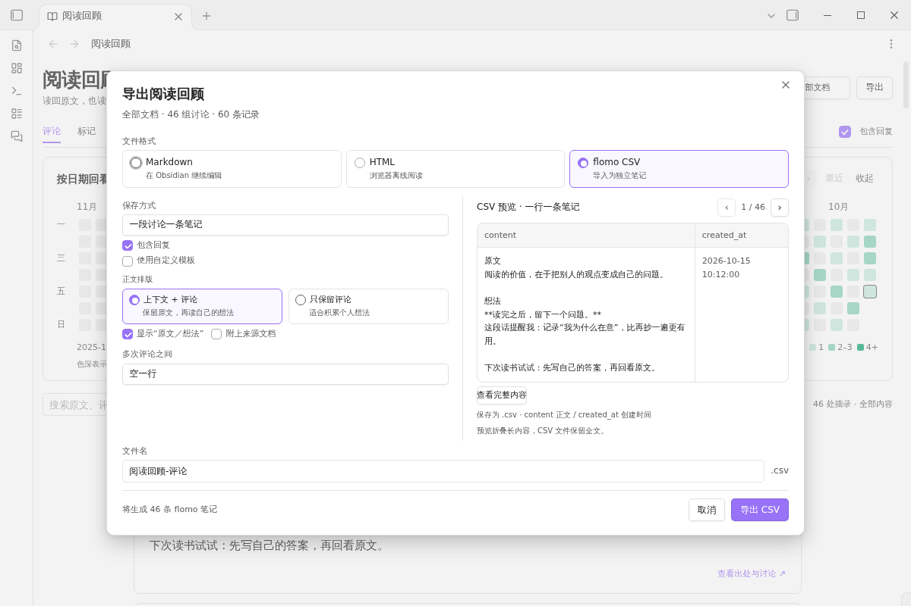
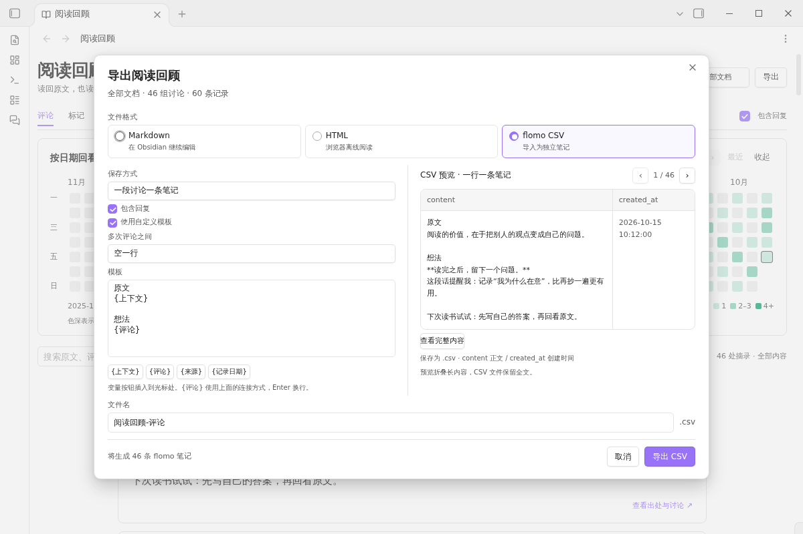

# Highnote

**Keep your thoughts beside the text. Return to them when you need them.**

Highnote brings compact comments and highlights to Markdown reading in Obsidian, a review dashboard with a date heatmap, and flexible exports for flomo. Your annotations stay in your vault without being inserted into the Markdown source.

[Community page](https://community.obsidian.md/plugins/highnote) · [Download a release](https://github.com/jinchengrui/obsidian-highnote/releases) · [中文说明](#中文说明)

**Obsidian 1.14.4+ · Desktop, phone and tablet annotations · Chinese interface · Free and open source**

Screenshots show the current Chinese interface with example notes.

## Compact comments beside your notes

Select a passage in Reading view to add a comment or highlight. The compact sidebar keeps the original excerpt above your thoughts, with full comments and replies available in the discussion. Hover to reveal reply controls; the surrounding cards stay in place.

- **Stay with the text.** Select a discussion to highlight its passage. Click its source excerpt to navigate; selecting comment text keeps your reading position.
- **Keep a thought going.** Add replies, edit or delete individual messages, and resolve a discussion when you are finished. Comments support bold text and ordered or unordered lists.
- **Find it again.** Browse the current note or all notes, search excerpts and comments, and filter resolved or unresolved discussions. All-note summaries group related messages to use less space.

The sidebar follows Obsidian's light and dark themes. Highlights use one shared color, configurable in settings. This is a personal annotation tool; no author avatars, accounts, mentions, or collaboration setup are needed.

## Review your reading by date

Open **阅读回顾** (Reading review) from the sidebar menu to bring annotations from across your vault into one workspace.

On phones and tablets, long-press text in Reading view and tap **评论** (Comment) or **标记** (Highlight) in the bottom annotation toolbar. Tap an underline or highlight to open its annotation drawer, where you can reply, edit, delete or resolve discussions. Use the book icon or **Highnote: 打开阅读回顾** to browse saved annotations. The mobile calendar starts collapsed; touch controls and the composer adapt to the available screen and keyboard space.

- Switch between comments and highlights, and between the current note and all notes.
- Use the heatmap to select a date, or search original excerpts, comments, and source note names. A matching discussion retains its context and related replies.
- Open a card's source details and choose **回到原文** (Back to source) to return to the note. Wide windows can show the review and source side by side.

The heatmap counts annotation records by creation date; it does not measure time spent reading. The review uses your current saved annotations. It does not create a second archive of discussions. Original excerpts are retained from the time you annotated them, so a later source edit does not erase what prompted the thought.

## Take your thoughts to flomo

Choose **导出** (Export) in Reading review, then **flomo CSV**. Preview the result before saving a CSV file for import into flomo.

Choose one memo per discussion or one per message. Include replies, keep the original excerpt with your comments or export comments alone, and optionally append the source note name. Choose how successive messages are separated.

For a custom layout, use the template variables `{上下文}` (excerpt), `{评论}` (comments), `{来源}` (source), and `{记录日期}` (record date). The preview shows the actual `content` and `created_at` fields that will be written to the CSV. Long previews have a full-content view; exported content is not truncated.

**This is a local CSV export, not an automatic flomo sync.** Import the saved file using flomo's import feature. Highnote does not connect to flomo or require a flomo API key.

| Format | Best for | Contents |
| --- | --- | --- |
| Markdown | Continuing to write in Obsidian | Original excerpts, comments or highlights, and source details |
| HTML | Reading outside Obsidian | A standalone file for offline browser reading |
| flomo CSV | Adding reading thoughts to flomo | Comments, optional replies and excerpts, and record dates |

Exports support the current note or all notes and are saved to the vault root. Existing filenames receive a numeric suffix. The document scope determines the export; review search, date filters, and on-screen pagination do not narrow it. Unsubmitted drafts and deleted messages are excluded. CSV is available for comments; highlights can be exported as Markdown or HTML.

Mobile review supports the same export formats. HTML and CSV are saved in the vault without launching a desktop application.

## Get started

1. Open the [Highnote community page](https://community.obsidian.md/plugins/highnote). When **Add to Obsidian** is available, use it to install, then enable Highnote in **Settings → Community plugins**. If the listing is still under review, use the manual installation below.
2. Open a Markdown note in **Reading view**. Select a passage and choose the comment or highlighter button.
3. Continue the discussion in the sidebar, or open **阅读回顾** from its menu to review and export your annotations.

Annotation creation, editing, replies, deletion, and resolution require Reading view. Source mode and Live Preview let you view annotations without modifying them.

Manual installation

Download `main.js`, `manifest.json`, and `styles.css` from the same [GitHub release](https://github.com/jinchengrui/obsidian-highnote/releases). Put all three in `.obsidian/plugins/highnote/` inside your vault, then enable Highnote in **Settings → Community plugins**. Use your actual configuration directory if it has a different name.

## Your notes and your data

Annotations use **`Highnote/annotations/`** by default, with one JSON file per annotated note path. Change **批注数据目录** (Annotation data directory) in **Settings → Highnote** to any vault-relative directory, such as `Highnote/annotations`, and click **应用** (Apply). Enter the complete data directory; another `annotations` folder is not appended. Desktop, phone and tablet should use the same relative path. Highnote does not insert annotation markup into your Markdown source. Include the selected directory in backups or sync; copying a `.md` file alone does not copy its annotations. Exports are reading copies, not a replacement for the JSON backup.

**For Obsidian Sync**, set the data directory to `Highnote/annotations` on both devices, enable **Sync all other types** in Sync settings, and ensure `Highnote` is not excluded. [Obsidian Sync excludes ordinary hidden folders](https://help.obsidian.md/sync/settings), so users of the old `.obsidian-highnote/` directory should migrate it using the desktop settings below. After syncing, tap **刷新** (Refresh) in mobile Reading review.

**Migrating an existing directory (desktop):** Open **Settings → Highnote → 迁移批注数据** (Migrate annotation data). The source defaults to `.obsidian-highnote` and the destination is prefilled with `Highnote/annotations`; review or change the destination and click **迁移** (Migrate). Highnote reads note JSON files from the source and its `annotations` subfolder, validates and copies them, then switches to the destination automatically. Source files remain as a backup. Identical files are skipped; conflicting or invalid files stop migration without overwriting them. If copying is interrupted, the current directory stays unchanged and you can retry. Existing explicit directory settings are retained when upgrading. Match the new directory on your mobile device after migration. Exports and Markdown source files are not moved.

The Apply button only selects where Highnote reads and saves annotations. Use Migrate annotation data when you also want to copy your existing annotations. An absent directory is created when an annotation is first saved. Invalid paths, occupied parent folders and malformed annotation files prevent switching. Export files continue to use the vault root.

Mobile supports comments, replies and highlights in Markdown Reading view. Long-press a passage, adjust the selection, then tap Comment or Highlight in the bottom annotation toolbar. Tap an existing underline or highlight to open the annotation drawer. Edit, delete and resolve actions are visible without hover; Tap Reply to open a composer; Enter inserts a newline and Send submits it. In short landscape viewports, search and filters are available through the filter button. Phone and tablet layouts adapt to the available pane width, orientation and keyboard. Unchanged JSON files and parsed records are cached, and active annotation/review views check for external changes every 15 seconds. Missing source notes on a partially synced device are not marked as deleted. Conflicting saves stop rather than overwrite newer data; the draft is retained.

| When this happens | Highnote's behavior |
| --- | --- |
| A tracked edit changes the text before a passage | The anchor follows the edit when its position can be established reliably |
| A passage is removed or can no longer be located reliably | The saved excerpt and discussion remain available, marked as unlocatable |
| A note or folder is renamed inside Obsidian | Annotation paths are updated |
| A source note is deleted | Annotations remain available with a missing-source state |
| Another process changes the annotation file before a save | The conflicting save stops; the input draft is retained for retry |
| The last message in a discussion is deleted | The empty discussion and underline are removed; a separate highlight is retained |

Drafts last only for the current plugin session. Migration supports the current per-note JSON schema; unsupported older test formats are reported without modifying them. Empty JSON files may remain after annotations are deleted or a note is moved; they contain no historical message snapshot and can be reused by that note path.

Selection works best with ordinary text in a paragraph or list. Selections across complex rendered blocks, embeds, tables, or formulas may not map reliably to source text. Unlocatable passages are not silently rebound. Concurrent edits across devices are not automatically merged.

### Privacy and permissions

- **Network:** No network requests, telemetry, advertising, or automatic installation of updates or dependencies. Exports are saved locally; Highnote does not upload annotations. Downloading development dependencies is a separate build-time operation.
- **Filesystem:** Annotation reads and writes use Obsidian's `DataAdapter`. On desktop, `node:fs.watch` monitors only the configured annotation directory inside this vault to detect external changes, including hidden directories outside the regular Vault index. Changing directories closes the previous watcher; unloading closes the current watcher. This Node.js use does not read or write files outside the vault.
- **Clipboard:** The HTML exporter includes a **Copy path** button. Clicking it writes the note's vault-relative path to the clipboard. It never reads the clipboard or monitors clipboard changes.
- **External applications:** On desktop, opening an HTML export uses the system's default application for the saved local file. Mobile saves the file without launching an external application. Nothing is uploaded.

The review and sidebar render records in batches, and long discussions have message pagination. All saved content remains searchable and available for export. Saving one note still involves its JSON file, so the cost grows with that note's annotations.

## 中文说明

**在原文旁写下想法，回顾时读懂当时的自己。**

Highnote 为 Obsidian 的 Markdown 阅读提供简洁的批注侧栏、按日期回顾的看板，以及适合导入 flomo 的 CSV 导出。评论和标记保存在笔记库中，不写进 Markdown 正文。

适用于 **Obsidian 1.14.4 及以上**。电脑、手机和平板均支持评论、标记和阅读回顾；当前界面为中文。免费，使用 MIT 许可。

### 简洁批注，把空间留给内容

阅读模式选中文字，即可添加评论或高亮。侧栏按“原文在上、想法在下”展示，评论与回复保留全文，长讨论可翻页查看。回复入口悬停出现，不挤动卡片；选中的讨论带有淡蓝色背景，并与原文联动。

点击原文摘录才跳转，选择评论文字时保持阅读位置。可以连续回复、编辑或删除消息，也可以把讨论标记为已解决。支持当前文档和全部文档查看，全部文档会合并展示同一讨论，让浏览更紧凑。侧栏跟随明暗主题，标记使用设置中统一指定的颜色。

[查看批注侧栏截图](docs/screenshots/showcase-comments.png)

### 阅读回顾看板，找回散落的想法

从侧栏菜单打开“阅读回顾”，集中查看当前文档或全部文档的评论、回复与标记。热力图按创建日期展示记录数量，点击日期即可回看当天的记录；搜索支持原文、评论和来源文档。热力图统计批注记录，不统计阅读时长。

回顾页跟随已保存批注的变化，不会另外快照一份讨论。创建批注时的原文摘录会保留，便于理解当时的语境。打开“查看出处与讨论”后，可以通过“回到原文”定位；窗口足够宽时，回顾与原文并排显示。

[查看回顾看板](docs/screenshots/showcase-review.png) · [查看原文联动](docs/screenshots/showcase-source.png)

### 导出到 flomo，自己决定保留什么

在阅读回顾右上角点击“导出”，选择 **flomo CSV**。可以选择“一段讨论一条笔记”或“一条消息一条笔记”，决定是否包含回复、原文与来源。既可以保留“原文＋想法”，也可以只导出自己的评论。

自定义模板支持 `{上下文}`、`{评论}`、`{来源}`、`{记录日期}`，可调整内容顺序和多次评论之间的连接方式。右侧预览 CSV 的 `content`、`created_at` 字段，长内容可单独展开查看，保存的文件保留全文。

这是**先导出本地 CSV，再到 flomo 导入**的流程，不会自动同步，也不需要填写 flomo API Key。纯标记可导出 Markdown 或 HTML；flomo CSV 用于评论。

[查看 flomo 导出](docs/screenshots/showcase-flomo.png) · [查看自定义模板](docs/screenshots/showcase-template.png)

### 安装与使用

1. 打开 [Highnote 官方社区页](https://community.obsidian.md/plugins/highnote)，安装入口可用时点击 **Add to Obsidian**，再到“设置 → 第三方插件”启用。若仍处于审核中，可从 [GitHub Releases](https://github.com/jinchengrui/obsidian-highnote/releases) 下载同一版本的三个安装文件，放入 `.obsidian/plugins/highnote/`。
2. 打开 Markdown 笔记并切换到**阅读模式**，选中文字添加评论或标记。
3. 从侧栏菜单进入“阅读回顾”，集中查看记录，或在右上角选择导出。

手机和平板在 Markdown **阅读模式**下，长按选中文字并调整范围，点击底部的“评论”或“标记”。点击已有原文下划线或高亮可打开批注抽屉，查看全文、回复、编辑、删除、解决或重新打开讨论。点击“回复”打开独立输入弹窗，按回车换行，点击“发送”提交；标记完成后停留在正文。“返回阅读”可收起抽屉。编辑模式下仅可查看批注。

界面按可用宽度适配大屏手机、iPad 横竖屏及分屏，主要触控按钮至少 44 像素，输入字号 16 像素，评论与回复弹窗随键盘可视区域调整。手机横屏高度较小时，搜索与筛选收进顶部筛选按钮，给评论列表留出空间。从书本图标或“Highnote：打开阅读回顾”命令进入回顾页，支持搜索、日期筛选和 Markdown、HTML、flomo CSV 导出。

**使用 Obsidian Sync 时**，在电脑和手机的“设置 → Highnote → 批注数据目录”都填 `Highnote/annotations`，点击“应用”。两端分别开启“同步所有其他类型”，确认 `Highnote` 不在排除目录中，重启应用后等待同步，再点手机回顾页“刷新”。[Obsidian Sync 不同步普通隐藏目录](https://help.obsidian.md/sync/settings)，使用旧 `.obsidian-highnote` 目录的用户，请先在桌面端按下方说明迁移。

**迁移历史批注（桌面端）：** 打开“设置 → Highnote → 迁移批注数据”，源目录默认 `.obsidian-highnote`，目标目录已预填 `Highnote/annotations`，确认或修改后点击“迁移”。插件会识别源目录及其 `annotations` 子目录中的批注 JSON，校验复制后自动切换。源文件保留为备份；相同文件跳过，遇到冲突或损坏则停止，不覆盖。中断时当前目录不变，已复制文件可供重试复用。升级保留明确配置过的目录，未配置时采用新默认；手机同步后应使用同一个新目录。迁移不搬动正文或导出文件。

配置填写完整的笔记库内相对目录，不会自动再追加 `annotations`。“应用”只切换读写位置；需要同时搬移已有批注时，请使用“迁移批注数据”。不存在的目录在首次保存批注时创建。路径无效、同名文件占用目录或目标批注文件损坏时不切换。导出文件继续存笔记库根目录。

手机端与电脑使用相同的批注 JSON，通过原子校验保存修改；遇到同步冲突时停止保存并保留输入草稿。原笔记尚未同步或暂时不可用时，不将批注标为已删除。阅读或批注界面处于前台时每 15 秒检查文件信息，复用未变化的数据；手动刷新会重新读取全文。

非阅读模式可以查看批注，不能新增、回复、编辑、删除或解决讨论。没有账号、多人协作、提及或提醒功能，适合个人阅读和写作。

导出范围可选当前文档或全部文档，文件默认存笔记库根目录，重名自动追加序号。搜索、日期筛选及分页不改变导出范围，未发送草稿和已删除消息不导出。

### 备份、边界与隐私

- **备份整个批注目录。** 评论和标记默认位于 `Highnote/annotations/`，可在“批注数据目录”中配置。单独复制 Markdown 不会带走批注，导出文件也不能替代 JSON 备份。旧目录可在桌面端通过“迁移批注数据”手动迁移。
- **原文变化后保留想法。** 能可靠确认位置的编辑会更新锚点；原文删除或无法定位时保留摘录与讨论，不自动绑定到另一段相似文字，也不提供手动重新绑定。
- **保存冲突时停止覆盖。** 发现同步工具或其他窗口改动文件时，停止当前保存，保留草稿供重新加载后重试。多设备同时写入仍可能冲突；未提交草稿不跨插件重启保存。
- **本地处理。** 插件不发起网络请求，不上传批注，不含遥测、广告、自更新或自动安装依赖。批注由 Obsidian DataAdapter 访问；桌面端 `node:fs.watch` 仅监听当前库的批注目录，卸载时关闭，手机版不加载 Node.js 或 Electron 模块。
- **按操作使用剪贴板。** HTML 导出页的“复制路径”只在点击时写入库内相对路径，不读取或监听剪贴板；打开 HTML 文件交给系统默认应用。

## Development

Use Node.js 22 or later. Install locked dependencies with `npm ci`; run `npm run dev` for a watch build. Before releasing, run `npm run lint`, `npm test`, `npm run build`, and `npm run package`. Installable files are written to `dist/highnote/`.

The GitHub Actions workflow checks the project and generates artifact attestations for builds from the public repository's default branch. Upload the three files from that run unchanged to a GitHub Release whose tag exactly matches `manifest.json`'s version, without a `v` prefix. Local build files do not automatically have GitHub attestations.

## License and feedback

MIT. Copyright (c) 2026 jinchengrui. See [LICENSE](LICENSE).

[Report an issue](https://github.com/jinchengrui/obsidian-highnote/issues) · [更新记录](docs/更新记录.md)

The interaction concept was inspired by [FloatMark](https://github.com/jinchengrui/obsidian-float-mark). Highnote was implemented independently and does not include source code from that project.
