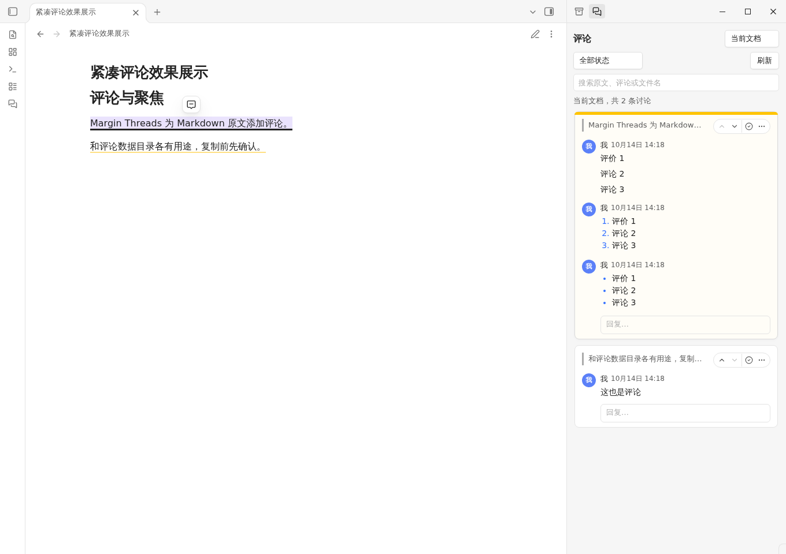

# Highnote

Add local comments, replies, and highlights to Markdown passages in Obsidian. Review your annotations in a dedicated workspace and export them as Markdown, HTML, or flomo-compatible CSV.

Highnote requires **Obsidian 1.14.4 or later on desktop**. The plugin interface is currently in Chinese. It is designed for personal use and does not provide accounts, collaboration, mentions, or notifications.

## Features

- Select text in Reading view to add a comment or highlight. Continue a discussion with replies, edit individual messages, and mark discussions as resolved.
- Browse annotations for the current note or all notes. Click a source excerpt to return to its passage. Discussions are retained if their original passage can no longer be located.
- Review saved comments and highlights in the reading review workspace. Export complete saved content as Markdown or HTML; comments can also be exported as CSV for import into flomo.
- Annotation changes are available in Reading view. Editing modes allow viewing annotations without modifying them.

## Installation

Until the community directory listing is available, download `main.js`, `manifest.json`, and `styles.css` from the same [GitHub release](https://github.com/jinchengrui/obsidian-highnote/releases). Place them in your vault's `.obsidian/plugins/highnote/` directory, then enable **Highnote** in **Settings → Community plugins**. Use your actual configuration directory if it has a different name.

Open a Markdown note in Reading view, select a passage, and choose the comment or highlighter button. Use the sidebar's menu to open the reading review workspace and export your annotations.

## Storage and privacy

Annotations are stored locally in `.obsidian-highnote/annotations/`, with one JSON file per annotated note path. Highnote does not insert annotations into your Markdown source. Include this hidden directory when backing up or syncing your vault; copying a Markdown file alone does not include its annotations. Earlier test data layouts are not imported or migrated.

- **Network:** The plugin does not make network requests or send annotations to flomo. CSV files are exported locally for you to import. There is no telemetry, advertising, or automatic installation of updates or dependencies. Installing development dependencies is a separate build-time operation.
- **Filesystem:** Annotation reads and writes use Obsidian's `DataAdapter` API. On desktop, `node:fs.watch` monitors only this vault's `.obsidian-highnote/annotations/` directory so external changes can be detected; hidden folders are outside the regular Vault file index. The plugin closes this watcher when unloaded and does not use Node.js to read or write files outside the vault.
- **Clipboard:** The HTML exporter includes a **Copy path** button. Only clicking that button writes the note's vault-relative path to the clipboard. It never reads the clipboard or monitors clipboard changes.
- **External applications:** Opening an HTML export uses the operating system's default application for the locally saved file. No export is uploaded.
- **Conflicts:** If another process changes an annotation file before a save, Highnote stops the conflicting save and preserves the input draft. It does not automatically merge concurrent changes from multiple devices.

## License

MIT. Copyright (c) 2026 jinchengrui. See [LICENSE](LICENSE).

## 中文说明

在 Obsidian 的 Markdown 笔记旁留下本地评论，在同一讨论中继续回复，并在原文位置失效时保留讨论。



适用于 **Obsidian 1.14.4 及以上桌面版**，界面语言为中文。首版不支持移动端。

回顾详情通过唯一的“回到原文”入口定位并打开讨论。导出窗口常用排版与自定义模板互相切换，CSV 预览显示 `content`、`created_at` 两列；长内容通过“查看完整内容”读取，保存文件仍保留全文。

历史变更和当时的验证结果见 [更新记录](docs/更新记录.md)。

## 可以做什么

- 阅读模式选中文字后，点击荧光笔直接标记，点击评论图标填写评论。两种操作也有同名命令。非阅读模式没有新增入口。
- 阅读模式选中文字后，点击选区旁自动出现的评论图标。蓝色下划线表示该段已有评论，选中的讨论对应原文增加淡蓝色背景，侧栏卡片显示蓝色左边线。
- 点击卡片或进入底部回复框，会选中该讨论并同步高亮，保持正文滚动位置；点击卡片顶部的原文摘录才定位，点击正文下划线可打开对应讨论。点击普通正文或空白处取消选中，移出鼠标仍保留选中。消息旁显示月日与时间，跨年显示年份，悬停可查看秒数。
- 将鼠标移到当前文档的卡片上，或用键盘聚焦卡片，底部出现“回复…”入口。Enter 发送、Shift+Enter 换行。可连续回复多次，消息按时间排列，不显示引用框。
- 评论正文支持 `**加粗**`、`- 无序列表`、`1. 有序列表`；其他 Markdown 语法按普通文本显示。
- 消息“…”菜单仅有编辑、删除；卡片右上角提供上一条／下一条讨论和解决按钮，不提供删除整个讨论入口。
- 在“当前文档”和“全部文档”间切换，按文件分组搜索评论，筛选已解决／未解决，并独立勾选无法定位的讨论。全部文档的合并内容包含评论和所有未删除回复，正文完整显示；点击后就地查看完整消息并回复、编辑、删除。“返回合并展示”收起讨论。
- 通过侧栏“…”打开阅读回顾，在右上角“导出”选择 Markdown、HTML 或 flomo CSV。现有导出命令也使用同一弹窗。生成独立文件；已删除消息不显示或导出，失效和已解决讨论保留状态。导出不替代 JSON 备份，也不提供导入或恢复绑定。

## 安装

1. 在 Obsidian 中创建一个独立测试笔记库并打开。
2. 将安装包里的 `highnote` 文件夹放入该库的 `.obsidian/plugins/`。最终路径为 `.obsidian/plugins/highnote/main.js`，同目录还应有 `manifest.json` 和 `styles.css`。如果修改过配置目录名，请使用实际目录。
3. 打开“设置 → 第三方插件”，关闭安全模式，然后启用 **Highnote**。
4. 打开 `.md` 笔记并切换到阅读模式，选中文字后添加评论或标记。左侧消息图标或“打开评论”命令可重新打开侧栏。

尚未发布到官方社区目录。发布前使用本地安装包。

## 评论和标记如何保存

评论和标记保存在笔记库根目录的 **`.obsidian-highnote/annotations/`** 文件夹，`annotations` 表示批注。每篇曾保存评论或标记的 Markdown 笔记对应一个 `note-<32位摘要>.json` 文件。摘要取笔记相对路径 SHA-256 的前 32 位十六进制，包含前缀和扩展名共 42 个字符。JSON 内保留完整路径、讨论、消息和标记 ID；加载校验名称与归属，发现冲突或损坏时停止覆盖。隐藏目录通过 Obsidian DataAdapter 读写，更新使用原子 process 校验冲突，不修改 Markdown 正文。本测试版只读取新命名的聚合 JSON，不加载或迁移旧版 UUID、64 位摘要文件。

| 操作 | 结果 |
| --- | --- |
| 在原文前插入文字，或在原文内做小幅编辑 | 编辑器记录能确认位置时，评论跟随原文 |
| 整段原文被替换、删除，或外部修改后无法可靠定位 | 保留引用及讨论，标记“原文位置失效” |
| 在 Obsidian 中改名、移动笔记或文件夹 | 评论更新到新路径 |
| 删除整个笔记 | 讨论保留，标记“原文件已删除” |
| 删除已被回复的消息 | 清空正文并隐藏该消息，后续回复保留 |
| 删除最后一条未删除消息 | 空讨论和下划线移除，同段标记保留；评论和标记都删空后，原子保存空 JSON，避免删除时误伤并发写入 |
| 卸载插件 | 评论数据目录保留；重新安装后可以加载 |

当前测试版只读取和写入 `.obsidian-highnote/annotations/`，不兼容旧测试目录或直接放在根目录下的旧 JSON，也不自动导入或迁移旧数据。父目录 `.obsidian-highnote` 统一收纳插件文件，`annotations` 子目录只保存评论和标记数据。隐藏目录不会出现在 Obsidian 常规文件列表中；备份或同步时需包含整个 `.obsidian-highnote`。

清空批注或在 Obsidian 中改名后，旧路径的空 JSON 会保留，内容不再进入评论索引。它不保存历史消息快照，文件数量随曾批注过的文档路径增长；重新使用该路径会复用文件。

原文位置失效后，讨论仍可在“全部文档”中查看。本版暂不提供重新绑定。

备份和迁移时需要同时包含 Markdown 文件与 `.obsidian-highnote`。单独复制 `.md` 不会带走评论。退出插件前保存正在输入的内容；新评论和回复的未提交草稿只在当前插件会话内保留，未持久化到磁盘。

行内回复入口固定预留 22px 高度和 3px 上边距，悬停或聚焦只改变可见性，不挤动其他讨论。点击后展开格式工具和发送按钮，支持中文输入法。已有草稿的回复框保持展开。未发送的回复草稿在本次插件会话内保留；取消会清空当前草稿。

## 边界与恢复

- **本地单人使用**：没有账号、实时协作、通知或 `@` 提醒。通过已有工具同步数据时，确保 JSON 文件被包含；首版未验证多设备同时写入。同一讨论在不同设备上同时修改仍可能产生同步冲突。
- **冲突时停止覆盖**：保存前会比较磁盘上的原数据。发现变化即停止保存并提示重新加载，输入框保留当前内容。重新加载后重新提交，不自动合并多端消息。
- **外部改名**：插件未运行时由其他软件改名的笔记无法保证自动识别，原讨论仍在“全部文档”中；恢复原路径后可重新定位。
- **阅读模式选区**：常见段落、加粗文字和列表可用。跨渲染块、复杂链接、嵌入、公式、表格等选区可能无法可靠映射源码；请缩小到同一段落中的普通文字。不会为了匹配相同短语而猜测位置。
- **数据损坏**：无效或未来版本的 JSON 会保留并提示，不覆盖为空数据。恢复备份后使用“…”中的“重新加载数据”。不要手工改文件名或回复标识。
- **失效后恢复**：一旦标记失效，恢复相同文本也不会静默重新关联，避免挂到另一段相同内容。
- **删除并非安全擦除**：插件会清除当前评论数据中的消息正文，但旧内容可能仍存在于你使用的文件历史、同步版本和备份中。

## 本地开发

需要 Node.js 22 或以上。先安装依赖，再运行开发构建：

```bash
npm ci
npm run dev
```

`dev` 监听源码变化并更新仓库根目录 `main.js`。修改后，把三个插件文件复制到测试库，然后禁用并重新启用插件。已有初始化完成的测试库时，可用复制脚本：

```bash
npm run install:local -- /absolute/path/to/test-vault
```

自定义配置目录可作为第二个参数传入。脚本只复制插件文件，不自动启用插件，不改评论数据。请将示例路径替换成自己的测试库路径。

发布前执行：

```bash
npm run lint
npm test
npm run build
npm run package
```

安装文件输出到 `dist/highnote/`。仓库包含依赖锁文件和 GitHub Actions 检查流程；公开仓库默认分支的推送或手动运行会为三个安装文件生成 GitHub 构建来源证明，通过后可下载 `highnote` 构建产物。其他分支和 PR 继续执行检查，不申请来源证明。正式发布时，将这次产物中的三个文件原样上传到 GitHub Release。

| 代码 | 作用 |
| --- | --- |
| `src/model.ts`、`src/store.ts` | 数据校验、消息关系、串行保存及冲突检测 |
| `src/anchors.ts` | 编辑器位置映射和外部修改后的保守重定位 |
| `src/editor.ts`、`src/reading.ts` | 后台编辑事务观察与阅读模式标注交互 |
| `src/reading-map.ts` | 阅读选区与 Markdown 源码的映射 |
| `src/ui.ts`、`src/format.ts` | 评论侧栏、输入框和有限格式渲染 |
| `src/main.ts` | 插件生命周期及 Obsidian 文件事件 |
| `src/review-export-modal.ts`、`src/flomo.ts` | 三格式导出窗口、模板与 CSV 生成 |
| `src/review.ts`、`src/review-model.ts`、`src/review-content.ts` | 主工作区回顾、增量检索与原文优先阅读导出 |

## 性能与主题

回顾页按批展示讨论及长讨论消息。侧栏也为长讨论提供每批 40 条消息的分页，正文与回复保留全文，导出范围不受分页影响。每篇 Markdown 仍对应一个 JSON，单篇文档的保存成本会随批注量增长。

默认保留蓝色评论焦点和绿色热力图。主题或 CSS 片段可覆盖 `--hn-accent` 与 `--hn-heat-accent`，统一调整侧栏、原文下划线、导出选中态及热力图。标记颜色仍由插件设置控制。

开发构建保留源码映射与可读代码，正式构建使用常规压缩减少安装包体积。

## 发布到官方社区

1. 作者与版权署名为 `jinchengrui`，发布前确认 `manifest.json` 与 `LICENSE` 中的署名一致。
2. 将源码放入你拥有的公开 GitHub 仓库。仓库根目录必须有 `README.md`、`LICENSE`、`manifest.json`；只提供内部仓库链接无法完成公开提交。
3. 确认插件名称与 ID 在官方目录中唯一，确认 `package.json`、`manifest.json`、`versions.json` 版本一致。
4. 将最终源码推送到公开仓库默认分支，等待 `Check plugin` 中的检查、构建和来源证明全部通过，下载该次 `highnote` 产物。创建 GitHub Release，标签与当前 `manifest.json` 中的版本完全相同，**不要加 `v`**。
5. 将产物里的 `main.js`、`manifest.json`、`styles.css` 分别作为 Release 附件上传，保持文件内容不变，以便来源证明匹配。ZIP 可额外提供，但不能替代这三个附件。本机构建的文件不自动具备 GitHub 来源证明。
6. 按[官方当前提交流程](https://docs.obsidian.md/plugins/releasing/submit-plugin)，登录 [Obsidian 社区目录](https://community.obsidian.md)，关联 GitHub 账号并添加插件，处理自动审核反馈。

每次升级提高版本号，重新构建并发布匹配标签的 Release。最终审核结果由官方决定。

## 隐私、许可与参考

插件免费，使用 MIT 许可。运行时不发送网络请求，不要求账号，不包含遥测、广告、自更新或远程依赖安装，不访问笔记库之外的文件。构建时 npm 下载依赖属于开发过程，不是插件运行时行为。

批注通过 Obsidian DataAdapter API 读写。桌面端额外使用 `node:fs.watch` 监听当前笔记库的 `.obsidian-highnote/annotations/`，用于发现外部同步或文件修改，卸载时关闭监听。该 Node.js 调用不读取或写入库外文件。HTML 导出页的“复制路径”只在点击时将库内相对路径写入剪贴板，不读取或监听剪贴板；打开 HTML 导出文件通过系统默认应用完成。

交互思路参考 [FloatMark](https://github.com/jinchengrui/obsidian-float-mark)，本项目在独立仓库中自行实现评论数据与界面，没有继承该项目源码。范围仅包含 Markdown 本地评论与标记。

开发及发布依据：[开发者政策](https://docs.obsidian.md/community-directory/developer-policies)、[提交要求](https://docs.obsidian.md/community-directory/submission-requirements-for-plugins)、[插件规范](https://docs.obsidian.md/Plugins/Releasing/Plugin+guidelines)。官方规则可能更新，提交时再次核对。
